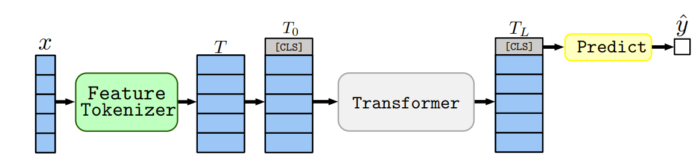
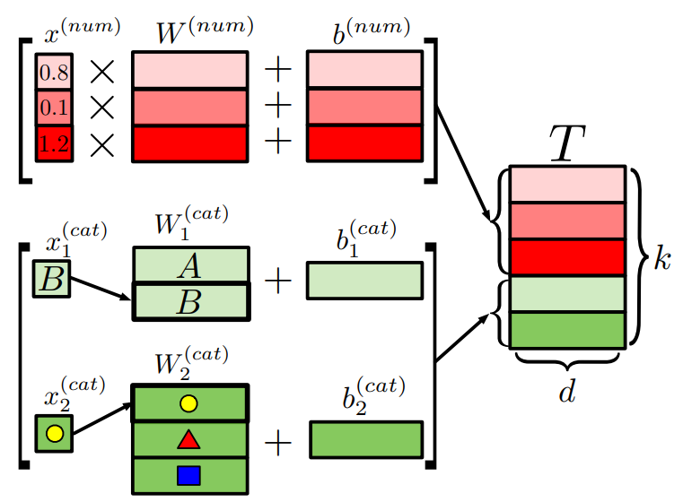
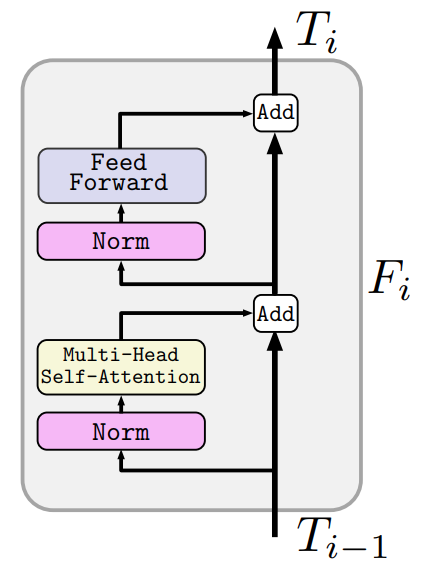
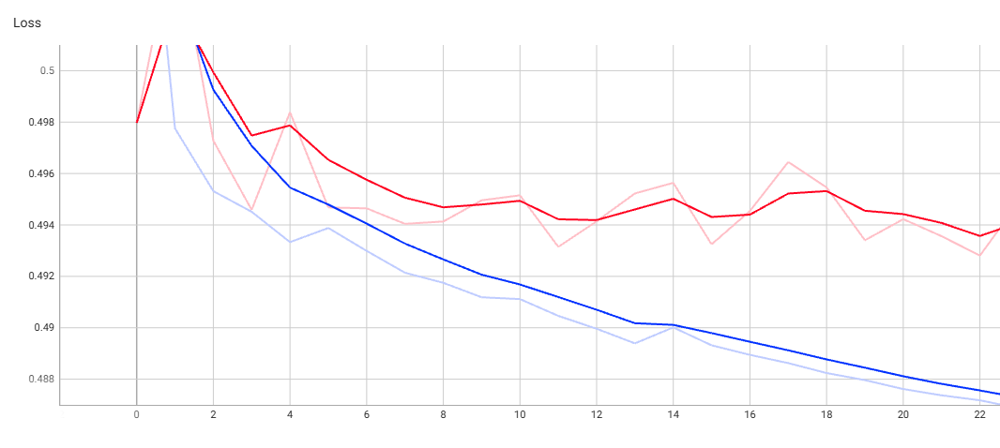
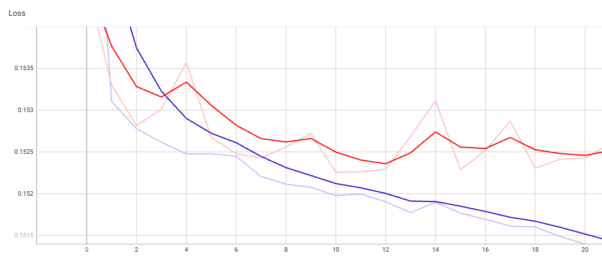
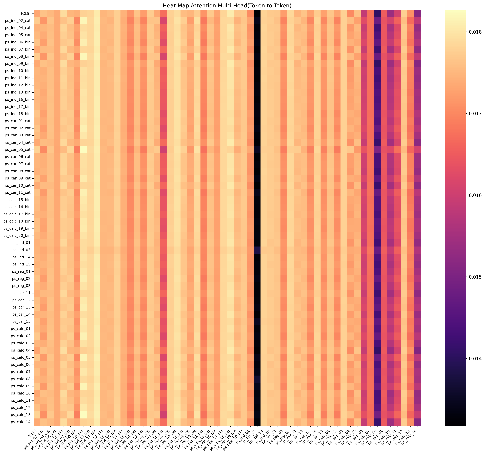

# PyTorch Reimplementation of "Feature Tokenizer Transformer Encoder Only"
This directory contains a PyTorch reimplementation based on the paper [Revisiting Deep Learning Models for Tabular Data](https://arxiv.org/abs/2106.11959) (Gorishniy et al., 2021).

This project reimplements an Encoder-only Transformer architecture, focusing on the methodology described in Section 3.3, FT-Transformer. The model is trained to predict the probability that a driver will file an insurance claim next year, using the [`CLS`] token for classification, on the [Porto Seguro's Safe Driver Prediction Kaggle Competition](https://www.kaggle.com/competitions/porto-seguro-safe-driver-prediction) dataset.

Two model sizes were trained, with approximately *1.4 million* and *25.37 million* parameters respectively, using an *NVIDIA A100 GPU*.

---

## Preprocessing
Preprocessing is implemented in `data/preprocess.py`. The `-1` values used in the dataset for missing data are first replaced with `NaN`. The dataset is then split into a training set and a development set (80%/20%), which is further split into validation and test sets (10%/10% of the full dataset).

Categorical columns are label-encoded, and continuous columns are imputed using the median. Both the encoders and the medians are fit exclusively on the training set and then applied to the validation and test sets, to avoid data leakage.

An `"unknown"` category is reserved during encoding so that categories not seen in training (or missing values not present in the training split) can be handled safely at validation/test time.

---

## Feature Tokenizer Transformer (Encoder-Only)
This architecture adapts the Transformer to tabular data. A `FeatureTokenizer` first converts each categorical and continuous column into its own vector representation (token), producing a sequence of tokens along with a learnable [`CLS`] token prepended to it. Unlike a standard Transformer, no positional encoding is used, since the order of the columns has no meaning.

This sequence is then processed by Transformer encoder blocks, where self-attention lets each token attend to every other token in the sequence. After the final block, the output representation of the `[CLS]` token is passed through the classification head to produce the prediction.

**Figure 1: Architecture Overview (Taken from original paper)**

### Feature Tokenizer
The pipeline starts by transforming the input features into embeddings that can be processed by the Transformer encoder. For this, the tokenizer maps each feature of the dataset into a token of dimension *d* = 512 for the 25.37 million-parameter model, and *d* = 192 for the 1.4 million-parameter model.

- Categorical values are represented by the index obtained during the encoding of the variables. This index is passed as input to PyTorch's [`nn.Embedding`], which holds a learnable embedding matrix for each categorical column:

  𝐸ⱼ(𝑥ⱼ) ∈ ℝᵈ

- Continuous values are projected from a scalar input using a dedicated [`nn.Linear`] layer per column:

  𝑒ⱼ = 𝑊ⱼ𝑥ⱼ + 𝑏ⱼ ∈ ℝᵈ

Each categorical and continuous column has its own independent embedding matrix or linear projection. The resulting tokens are concatenated, and the learnable `[CLS]` token is prepended to the sequence; its final representation is used as the global representation of the input for the prediction.

**Figure 2: Feature Tokenizer (Taken from original paper)**

---

## Transformer Encoder Architecture

**Figure 3: Transformer Encoder (Taken from original paper): The Transformer Encoder Only architecture**

The model architecture uses the standard Transformer encoder from [Attention Is All You Need](https://arxiv.org/abs/1706.03762). It consists of alternating layers of Multi-Head Self-Attention (MSA) and Multi-Layer Perceptron (MLP) blocks. Following modern architecture designs, Layer Normalization (LN) is applied *before* every block (Pre-Norm), and residual connections are applied *after* every block.

The internal forward pass is structured as follows:
* **Feature Tokenizer** concatenated with a learnable `[CLS]` token
* **Layer Normalization** applied before both the attention and MLP blocks
* **Multi-Head Self-Attention (MSA)** to model interactions between the feature tokens
* **Multi-Layer Perceptron (MLP)** with GELU activation function
* **Residual Connections** adding the input of each sub-layer to its output
* **Final Classification Head**: a linear projection layer that takes the final state of the `[CLS]` token and outputs the raw class logits

---

## Training Details & Results

Both models were trained from scratch on the Porto Seguro's Safe Driver Prediction dataset to learn the patterns driving insurance claims.

### Model Hyperparameters

| Hyperparameter | Model *25.37M* | Model *1.4M* |
|---|---:|---:|
| Layers | 8 | 3 |
| Hidden Dimensionality | 512 | 192 |
| MLP Size | 512 | 192 |
| Attention Heads | 8 | 3 |
| Dropout | 0.1 | 0.1 |
| Pos-Weight | 5 | 0 |

### Training Setup
* **Optimizer:** AdamW
* **Batch Size:** 2048
* **Regularization:** Early Stopping (patience: 5 epochs) and weight decay ($L_2$ regularization: 1e-4)
* **Learning Rate Scheduler:** CosineAnnealingLR
* **Loss Function:** Binary Cross-Entropy with Logits Loss

### Learning Curves

**Figure 4: Training curves, 25.37 million-parameter model.** Training loss (blue) and validation loss (red).

**Figure 5: Training curves, 1.4 million-parameter model.** Training loss (blue) and validation loss (red).

### Evaluation Metrics

After training, the models were evaluated on a held-out test set to verify their capacity to produce accurate predictions.

**Classification Report:**

| Metric | 25.37 Million | 1.4 Million |
| :--- | :---: | :---: |
| **Test Loss** | 0.2447 | 0.1534 |
| **Accuracy** | 0.8626 | 0.8859 |
| **F1-Score** | 0.1206 | **0.1217** |
| **AUPRC** | 0.0700 | **0.0728** |
| **AUROC** | **0.6581** | 0.6524 |
| **Norm Gini** | **0.3161** | 0.3047 |
| **Precision** | 0.0789 | **0.0849** |
| **Recall** | **0.2557** | 0.2146 |

---

### Visualizing Model Attention

**Figure 6: Model attention map, token to token.** To understand how the model attends to the different tokens when making a prediction, the attention matrix was visualized. As shown in Figure 6, no single variable stands out as having a particularly high importance for the prediction.

---

### Kaggle Submission
Both trained models were submitted to the Kaggle competition. The metric used is the normalized Gini coefficient (Gini = 2 * AUC - 1).

**Figure 7: Kaggle submission scores (private and public).** After submitting both models to the competition, the 1.4 million-parameter model achieved the best scores: a private score of 0.276 (vs. 0.273 for the 25.37 million-parameter model) and a public score of 0.272 (vs. 0.268).

---

## Conclusion
This project shows that a Feature Tokenizer Transformer, with no manual feature engineering, is able to learn useful patterns from the Porto Seguro dataset and achieve a reasonable score on the competition's leaderboard, considering that the top solutions relied on extensive feature engineering and gradient-boosted tree ensembles rather than deep learning.

The larger model (25.37 million parameters) did not outperform the smaller one (1.4 million parameters); if anything, it scored slightly worse on both the public and private leaderboards. This suggests that, for a dataset of this size, the smaller model's capacity was already sufficient to capture the relevant patterns, and that scaling up the model further did not translate into a sufficiently better fit, likely due to the limited and fairly noisy nature of the tabular data available.